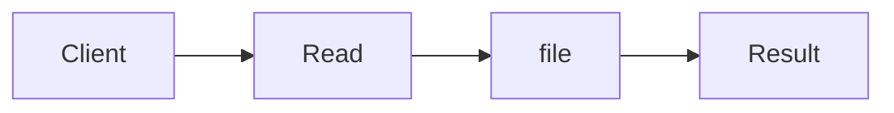

# Effect Systems & Interpreters

**Season:** 7 · Advanced FP · **Category:** Functional · **Level:** Advanced · **Runtime:** ~10–12 min · **Channel:** Build with Waqar

## Problem
**Read file → call service → write result; prod vs test interpreters**

Key types: `EffectProgram`, `Eff`, `ReadFile`, `HttpGet`, `WriteFile`, `Pure`.

## Hook
Picture this: you are mid-demo and «Read file → call service → write result; prod vs test interpreters» blows up the naive way — you see `caught=http-down`. That is the pain. In the next ten minutes we introduce **Effect Interpreters** with real types (EffectProgram, Eff, ReadFile), a runnable `ProblemDemo`, and the failure path locked in by tests. No abstract UML first — problem first.

## Intent
Use **Effect Interpreters** to cleanly solve: Read file → call service → write result; prod vs test interpreters.

**When to use:** the force behind «Read file → call service → write result; prod vs test interpreters» shows up more than once and a simpler language feature does not erase it.

**When to refuse:** you are pattern-collecting, the boundary is still unclear, or the team cannot yet test the abstraction (compensations, half-open recovery, interpreters).

## The Pain — Naive Design
Naive: effects inlined — cannot swap FS/HTTP for tests.

```java
package com.buildwithwaqar.patterns.functional.io.problem;

import java.util.Map;

/** Naive: effects inlined — cannot swap FS/HTTP for tests. */
public final class NaivePipeline {
    public static String run(Map<String, String> fs, String in, String out) {
        String content = fs.get(in);
        if (content == null) throw new IllegalStateException("missing");
        String resp = "OK:" + content; // hard-wired HTTP
        fs.put(out, resp);
        return resp;
    }
}

```

On camera, point at the smell: missing compensations, leaked XML, null at the boundary,
illegal transitions, or hard-wired `System.out` that you cannot assert.

## Pattern Structure


These roles are for **«Read file → call service → write result; prod vs test interpreters»** — not a generic Client→Pattern poster. Keep them on screen
while you type the solution.

## Refactor to the Pattern

### Stage 1 — Name the boundary
Introduce the client-facing API the rest of the app should depend on. Hide the incompatible or
distributed details behind it. For this episode that boundary is what makes «Read file → call service → write result; prod vs test interpreters» testable.

### Stage 2 — Encode the solution
```java
package com.buildwithwaqar.patterns.functional.io.problem;

import java.util.ArrayList;
import java.util.LinkedHashMap;
import java.util.List;
import java.util.Map;
import java.util.function.Function;

/**
 * Effect program: read a file → call a service → write a result.
 * Same AST runs under ProdInterpreter (in-memory FS+HTTP) and TestInterpreter (scripted).
 */
public final class EffectProgram {
    private EffectProgram() {}

    public sealed interface Eff permits ReadFile, HttpGet, WriteFile, Pure {}
    public record ReadFile(String path) implements Eff {}
    public record HttpGet(String url, String body) implements Eff {} // body = request payload from file
    public record WriteFile(String path, String content) implements Eff {}
    public record Pure(String value) implements Eff {}

    public abstract static class Prog<A> {
        private Prog() {}
        public abstract <B> Prog<B> flatMap(Function<? super A, Prog<B>> f);
        public final <B> Prog<B> map(Function<? super A, ? extends B> f) {
            return flatMap(a -> pure(f.apply(a)));
        }
        public static <A> Prog<A> pure(A a) { return new Return<>(a); }
        public static Prog<String> readFile(String path) { return new Suspend<>(new ReadFile(path)); }
        public static Prog<String> httpGet(String url, String body) { return new Suspend<>(new HttpGet(url, body)); }
        public static Prog<Void> writeFile(String path, String content) { return new Suspend<>(new WriteFile(path, content)); }
    }

    private static final class Return<A> extends Prog<A> {
        final A value; Return(A value) { this.value = value; }
        public <B> Prog<B> flatMap(Function<? super A, Prog<B>> f) { return f.apply(value); }
    }
    private static final class Suspend<A> extends Prog<A> {
        final Eff eff; Suspend(Eff eff) { this.eff = eff; }
        public <B> Prog<B> flatMap(Function<? super A, Prog<B>> f) { return new Bind<>(this, f); }
    }
    private static final class Bind<A, B> extends Prog<B> {
        final Prog<A> prev; final Function<? super A, Prog<B>> f;
        Bind(Prog<A> prev, Function<? super A, Prog<B>> f) { this.prev = prev; this.f = f; }
        public <C> Prog<C> flatMap(Function<? super B, Prog<C>> g) {
            return new Bind<>(prev, a -> f.apply(a).flatMap(g));
        }
    }

    public static Prog<String> reportPipeline(String inPath, String url, String outPath) {
        return Prog.readFile(inPath).flatMap(content ->
                Prog.httpGet(url, content).flatMap(resp ->
                        Prog.writeFile(outPath, resp).map(v -> resp)));
    }

    public interface Interpreter {
        <A> A run(Prog<A> program);
    }

    public static final class ProdInterpreter implements Interpreter {
        private final Map<String, String> fs;
        private final Function<String, String> http;
        private final List<String> log = new ArrayList<>();
        public ProdInterpreter(Map<String, String> fs, Function<String, String> http) {
            this.fs = fs; this.http = http;
        }
        public List<String> log() { return List.copyOf(log); }
        public Map<String, String> fs() { return Map.copyOf(fs); }
  
```

### Stage 3 — Runnable main
```java
package com.buildwithwaqar.patterns.functional.io.problem;

import java.util.HashMap;
import java.util.Map;

public final class ProblemDemo {
    public static void main(String[] args) {
        System.out.println("=== Effect Interpreters: read → HTTP → write ===");
        System.out.println("--- naive ---");
        var fs = new HashMap<String, String>();
        fs.put("/in.txt", "order-42");
        System.out.println(NaivePipeline.run(fs, "/in.txt", "/out.txt"));

        System.out.println("--- prod interpreter ---");
        var pfs = new HashMap<String, String>();
        pfs.put("/in.txt", "order-42");
        var prod = new EffectProgram.ProdInterpreter(pfs, body -> "SHIPPED:" + body);
        System.out.println(prod.run(EffectProgram.reportPipeline("/in.txt", "https://ship", "/out.txt")));
        System.out.println("log=" + prod.log());
        System.out.println("out=" + prod.fs().get("/out.txt"));

        System.out.println("--- test interpreter ---");
        var test = new EffectProgram.TestInterpreter(Map.of("/in.txt", "order-7"), "OK", false);
        System.out.println(test.run(EffectProgram.reportPipeline("/in.txt", "https://ship", "/out.txt")));
        System.out.println("writes=" + test.writes());

        System.out.println("--- test failure: http down ---");
        try {
            new EffectProgram.TestInterpreter(Map.of("/in.txt", "x"), "OK", true)
                    .run(EffectProgram.reportPipeline("/in.txt", "https://ship", "/out.txt"));
        } catch (IllegalStateException e) {
            System.out.println("caught=" + e.getMessage());
        }
    }
}

```

## Runnable Output (Verified on JDK 25)
Narrate each line. Do not invent numbers on camera.

```text
=== Effect Interpreters: read → HTTP → write ===
--- naive ---
OK:order-42
--- prod interpreter ---
SHIPPED:order-42
log=[read:/in.txt, http:https://ship, write:/out.txt]
out=SHIPPED:order-42
--- test interpreter ---
OK
writes={/out.txt=OK}
--- test failure: http down ---
caught=http-down
```

Happy-path cue: `OK:order-42`.
Failure-path cue: `caught=http-down`.
Fork the repo, set `JAVA_HOME` to JDK 25, and re-run the same `ProblemDemo` to verify.

## Modern Java 25 / Zazr Variant
This solution already leans on **sealed types** — keep the exhaustive `switch`. **Records** carry the immutable results (`StepResult`, DTOs) with almost no boilerplate.

## Trade-offs
- **Clarity vs ceremony:** extra types for «Read file → call service → write result; prod vs test interpreters» only pay off when the force repeats.
- **Testability:** inject collaborators; assert the failure path, not only the happy path.
- **Distributed / concurrent reality:** demos omit metrics, backpressure, and multi-region clocks.
- **Refuse Effect Interpreters** when a sealed switch, a function value, or a simpler library call already erases the force.
- **Neighbor:** Tagless Final — Effect interpreters separate description from execution — same spirit as Tagless.

## Interview Q&A
**Q1. What concrete problem does Effect Interpreters solve here?**
A: Read file → call service → write result; prod vs test interpreters.

**Q2. What does the naive design get wrong?**
A: Naive: effects inlined — cannot swap FS/HTTP for tests.

**Q3. How do you test the failure path?**
A: Inject the fault and assert the observable outcome — e.g. `caught=http-down`.

**Q4. When is Effect Interpreters the wrong tool?**
A: When a smaller language feature erases the force, or when you really needed Tagless Final.


## Key Takeaways
- Lead with the problem: Read file → call service → write result; prod vs test interpreters.
- Show naive pain (`caught=http-down`) before naming Effect Interpreters.
- Run the Demo; trust JDK 25 stdout (`OK:order-42`).
- Teach when NOT to use Effect Interpreters.

## Video Script (≈10–12 minutes)
Record for **Build with Waqar**. OBS for capture, CapCut for assembly. Import `slides.pdf`.
Facecam: full-screen for the hook, framed PiP over code slides.

**[0:00]** *(slide 01 title + talking head)*
Hey everyone — today we solve one concrete problem with **Effect Interpreters**:
*Read file → call service → write result; prod vs test interpreters*. Keep these names in your head: EffectProgram, Eff, ReadFile, HttpGet.

**[0:45]** *(problem + hook slides)*
I am not starting with a textbook definition. Here is the product pain. By the end you will have
seen the naive leak, the pattern boundary, and real JDK 25 stdout.

**[2:00]** *(naive code)*
IDE time. This is the naive version. Call out the smell — that is what Effect Interpreters exists to erase.

**[3:30]** *(structure diagram)*
Roles for **this** problem, not a generic UML poster. Point at each box while you talk.

**[4:30]** *(refactor / solution code)*
Stage the solution. Highlight failure injection and the tests that lock it in.

**[7:00]** *(walkthrough output)*
Real stdout. Happy path cue: `OK:order-42`.
Failure cue: `caught=http-down`.
No invented numbers on camera.

**[8:30]** *(modern Java 25 / Zazr + trade-offs)*
Show the modernization, then slow down for when NOT to use Effect Interpreters. That is what seniors listen for.

**[10:30]** *(Q&A + recap + outro)*
Two interview questions, three takeaways, link the GitHub episode folder. I am Waqar — see you in the next one.

