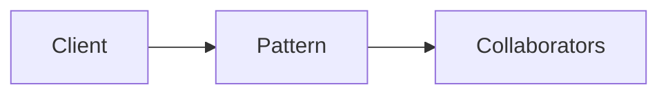

# Effect Systems & Interpreters

**Season:** 7 · Advanced FP · **Category:** Functional · **Level:** Advanced · **Target runtime:** ~10–12 min · **Channel:** Build with Waqar · **Target runtime:** ~10–12 min · **Channel:** Build with Waqar · **Target runtime:** ~10–12 min · **Channel:** Build with Waqar · **Target runtime:** ~10–12 min · **Channel:** Build with Waqar

## Problem
**Read file → call service → write result; prod vs test interpreters**

This episode is built around that concrete problem — not a shared StreamForge framing.
You will see a real naive implementation that hurts, a full pattern-based solution, a
runnable main with meaningful stdout, and JUnit failure-path coverage where the pattern lives.

## Hook
Welcome back to **Build with Waqar**. Today we earn **Effect Interpreters** by solving one problem well:
*Read file → call service → write result; prod vs test interpreters*. By the end you will have walked naive pain → pattern refactor → real JDK 25
stdout → trade-offs, with CapCut slides and a spoken script.

## Intent
Effect Interpreters exists because this force kept showing up: read file → call service → write result; prod vs test interpreters. Name the force, sketch
the roles, and — critically — know when you would refuse the pattern.

## The Pain — Naive Design
Before the pattern, teams usually thread details everywhere, leak resources on partial
failure, or couple call sites to a third-party shape. That feels fast on day one and expensive
on day thirty.

```java
package com.buildwithwaqar.patterns.functional.io.problem;

import java.util.Map;

/** Naive: effects inlined — cannot swap FS/HTTP for tests. */
public final class NaivePipeline {
    public static String run(Map<String, String> fs, String in, String out) {
        String content = fs.get(in);
        if (content == null) throw new IllegalStateException("missing");
        String resp = "OK:" + content; // hard-wired HTTP
        fs.put(out, resp);
        return resp;
    }
}

```

Call out the smell on camera: duplicated envelopes, missing compensations, parameter drilling,
illegal transitions, or null at the boundary.

## Pattern Structure


Roles matter more than class counts. The diagram slide draws the collaboration for **this**
problem so viewers can point at boxes while you type.

## Refactor to the Pattern

### Stage 1 — Name the boundary
Identify the client-facing API the rest of the app should depend on. Hide the incompatible
or distributed details behind it.

### Stage 2 — Encode the solution
```java
package com.buildwithwaqar.patterns.functional.io.problem;

import java.util.ArrayList;
import java.util.LinkedHashMap;
import java.util.List;
import java.util.Map;
import java.util.function.Function;

/**
 * Effect program: read a file → call a service → write a result.
 * Same AST runs under ProdInterpreter (in-memory FS+HTTP) and TestInterpreter (scripted).
 */
public final class EffectProgram {
    private EffectProgram() {}

    public sealed interface Eff permits ReadFile, HttpGet, WriteFile, Pure {}
    public record ReadFile(String path) implements Eff {}
    public record HttpGet(String url, String body) implements Eff {} // body = request payload from file
    public record WriteFile(String path, String content) implements Eff {}
    public record Pure(String value) implements Eff {}

    public abstract static class Prog<A> {
        private Prog() {}
        public abstract <B> Prog<B> flatMap(Function<? super A, Prog<B>> f);
        public final <B> Prog<B> map(Function<? super A, ? extends B> f) {
            return flatMap(a -> pure(f.apply(a)));
        }
        public static <A> Prog<A> pure(A a) { return new Return<>(a); }
        public static Prog<String> readFile(String path) { return new Suspend<>(new ReadFile(path)); }
        public static Prog<String> httpGet(String url, String body) { return new Suspend<>(new HttpGet(url, body)); }
        public static Prog<Void> writeFile(String path, String content) { return new Suspend<>(new WriteFile(path, content)); }
    }

    private static final class Return<A> extends Prog<A> {
        final A value; Return(A value) { this.value = value; }
        public <B> Prog<B> flatMap(Function<? super A, Prog<B>> f) { return f.apply(value); }
    }
    private static final class Suspend<A> extends Prog<A> {
        final Eff eff; Suspend(Eff eff) { this.eff = eff; }
        public <B> Prog<B> flatMap(Function<? super A, Prog<B>> f) { return new Bind<>(this, f); }
    }
    private static final class Bind<A, B> extends Prog<B> {
        final Prog<A> prev; final Function<? super A, Prog<B>> f;
        Bind(Prog<A> prev, Function<? super A, Prog<B>> f) { this.prev = prev; this.f = f; }
        public <C> Prog<C> flatMap(Function<? super B, Prog<C>> g) {
            return new Bind<>(prev, a -> f.apply(a).flatMap(g));
        }
    }

    public static Prog<String> reportPipeline(String inPath, String url, String outPath) {
        return Prog.readFile(inPath).flatMap(content ->
                Prog.httpGet(url, content).flatMap(resp ->
                        Prog.writeFile(outPath, resp).map(v -> resp)));
    }

    public interface Interpreter {
        <A> A run(Prog<A> program);
    }

    public static final class ProdInterpreter implements Interpreter {
        private final Map<String, String> fs;
        private final Function<String, String> http;
        private final List<String> log = new ArrayList<>();
        public ProdInterpreter(Map<String, String> fs, Function<String, String> http) {
            this.fs = fs; this.http = http;
        }
        public List<String> log() { return List.copyOf(log); }
        public Map<String, String> fs() { return Map.copyOf(fs); }
        @SuppressWarnings({"rawtypes", "unchecked"})
        public <A> A run(Prog<A> program) {
            Prog cur = program;
            while (true) {
                if (cur instanceof Return<?> r) return (A) r.value;
                if (cur instanceof Suspend<?> s) {
                    Object 
```

### Stage 3 — Runnable main
```java
package com.buildwithwaqar.patterns.functional.io.problem;

import java.util.HashMap;
import java.util.Map;

public final class ProblemDemo {
    public static void main(String[] args) {
        System.out.println("=== Effect Interpreters: read → HTTP → write ===");
        System.out.println("--- naive ---");
        var fs = new HashMap<String, String>();
        fs.put("/in.txt", "order-42");
        System.out.println(NaivePipeline.run(fs, "/in.txt", "/out.txt"));

        System.out.println("--- prod interpreter ---");
        var pfs = new HashMap<String, String>();
        pfs.put("/in.txt", "order-42");
        var prod = new EffectProgram.ProdInterpreter(pfs, body -> "SHIPPED:" + body);
        System.out.println(prod.run(EffectProgram.reportPipeline("/in.txt", "https://ship", "/out.txt")));
        System.out.println("log=" + prod.log());
        System.out.println("out=" + prod.fs().get("/out.txt"));

        System.out.println("--- test interpreter ---");
        var test = new EffectProgram.TestInterpreter(Map.of("/in.txt", "order-7"), "OK", false);
        System.out.println(test.run(EffectProgram.reportPipeline("/in.txt", "https://ship", "/out.txt")));
        System.out.println("writes=" + test.writes());

        System.out.println("--- test failure: http down ---");
        try {
            new EffectProgram.TestInterpreter(Map.of("/in.txt", "x"), "OK", true)
                    .run(EffectProgram.reportPipeline("/in.txt", "https://ship", "/out.txt"));
        } catch (IllegalStateException e) {
            System.out.println("caught=" + e.getMessage());
        }
    }
}

```

## Hand-Traced Walkthrough (Verified on JDK 25)
Narrate each line. Do not invent numbers on camera.

```text
=== Effect Interpreters: read → HTTP → write ===
--- naive ---
OK:order-42
--- prod interpreter ---
SHIPPED:order-42
log=[read:/in.txt, http:https://ship, write:/out.txt]
out=SHIPPED:order-42
--- test interpreter ---
OK
writes={/out.txt=OK}
--- test failure: http down ---
caught=http-down
```

Trace: match each printed line to a stage above. Fork the repo, set `JAVA_HOME` to JDK 25,
and re-run the same main class to verify.

## Modern Java 25 / Zazr Variant
Prefer records for results, sealed types for closed variants, pattern matching for exhaustive
handling, virtual threads for blocking fan-out, and Zazr for Option/Either/Try/Validation
when the force is about absence or accumulated errors. Keep the classic shape when interview
literacy matters.

## Trade-offs
- **Clarity vs ceremony:** five types for a two-line problem is a fail.
- **Testability:** inject collaborators; for Saga, inject failure at each step.
- **Distributed reality:** teaching demos omit metrics, poison pills, and multi-region clocks.
- **Refuse the pattern** when a sealed switch, a function value, or a simpler library call
  already erases the force.

## When to Use / When Not to Use
**Use when** the problem above shows up more than once and a simpler language feature does
not erase it.

**Avoid when** you are pattern-collecting, when the boundary is still unclear, or when the
team cannot yet test the abstraction (especially compensations and half-open recovery).

## Related Patterns
Contrast Effect Interpreters with its usual twin (Adapter vs Facade, Saga vs Outbox, Reader vs DI/Cake,
State vs Strategy, Free vs Tagless). Say the distinguishing sentence out loud.

## Interview Q&A
**Q1. What concrete problem does Effect Interpreters solve here?**
A: Read file → call service → write result; prod vs test interpreters.

**Q2. What does the naive design get wrong?**
A: Point at the naive code smells from this episode.

**Q3. How do you test failure paths?**
A: Inject a failing collaborator (Saga step, SOAP fault, missing file) and assert the
observable outcome — compensation order, FAILED result, or thrown IllegalStateException.

**Q4. When is Effect Interpreters the wrong tool?**
A: Give a smaller counterexample where a function, Option, or facade is enough.

**Q5. How does Java 25 change the encoding?**
A: Records, sealed types, virtual threads, Zazr control types — pick what applies.

## Key Takeaways
- Lead with the problem: Read file → call service → write result; prod vs test interpreters.
- Show naive pain before naming Effect Interpreters.
- Run the Demo; trust JDK 25 stdout.
- Teach when NOT to use it.

## Video Script (≈10–12 minutes)
Record for **Build with Waqar**. OBS for capture, CapCut for assembly. Import `slides.pdf`.

**[0:00]** *(slide 01 title)*
Hey everyone, welcome back to Build with Waqar. Today we solve a real problem with Effect Interpreters:
Read file → call service → write result; prod vs test interpreters.

**[0:40]** *(slide 02–03 problem)*
I am not starting with a definition. Here is the product pain. Keep these names — they
reappear in the Demo output.

**[2:00]** *(naive code)*
IDE time. This is the naive version. Call out the smell.

**[3:30]** *(diagram)*
Structure for **this** problem. Point at each role.

**[4:30]** *(refactor stages)*
Stage by stage into the pattern. Highlight tests and failure injection.

**[7:00]** *(walkthrough output)*
Real stdout from JDK 25. Line by line. No fake numbers.

**[8:30]** *(modern + trade-offs)*
Java 25 / Zazr take, then slow down for when NOT to use Effect Interpreters.

**[10:30]** *(interview + recap)*
Two interview questions, three takeaways, link the GitHub episode folder. I am Waqar —
see you in the next one.
