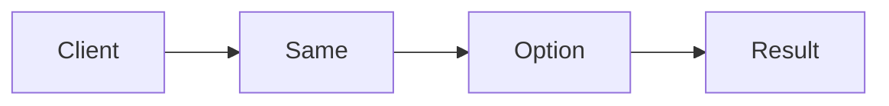

# VAVR vs Zazr Deep Dive

**Season:** 7 · Advanced FP · **Category:** Libraries · **Level:** Advanced · **Runtime:** ~10–12 min · **Channel:** Build with Waqar

## Problem
**Same Option describe in both libraries**

Key types: `OptionCompare`.

## Hook
Picture this: you are mid-demo and «Same Option describe in both libraries» blows up the naive way — you see `none`. That is the pain. In the next ten minutes we introduce **VAVR vs Zazr** with real types (OptionCompare), a runnable `ProblemDemo`, and the failure path locked in by tests. No abstract UML first — problem first.

## Intent
Run the same Option describe program on real VAVR and real Zazr side by side.

**When to use:** the force behind «Same Option describe in both libraries» shows up more than once and a simpler language feature does not erase it.

**When to refuse:** you are pattern-collecting, the boundary is still unclear, or the team cannot yet test the abstraction (compensations, half-open recovery, interpreters).

## The Pain — Naive Design
Naive version fails to cleanly solve: Same Option describe in both libraries

```java
package com.buildwithwaqar.patterns.functional.vavrcompare.problem;

import java.util.*;

public final class NaiveOpt {
  public static String describe(String s){ return s==null? "none": "some:"+s; }
}

```

On camera, point at the smell: missing compensations, leaked XML, null at the boundary,
illegal transitions, or hard-wired `System.out` that you cannot assert.

## Pattern Structure


These roles are for **«Same Option describe in both libraries»** — not a generic Client→Pattern poster. Keep them on screen
while you type the solution.

## Refactor to the Pattern

### Stage 1 — Name the boundary
Introduce the client-facing API the rest of the app should depend on. Hide the incompatible or
distributed details behind it. For this episode that boundary is what makes «Same Option describe in both libraries» testable.

### Stage 2 — Encode the solution
```java
package com.buildwithwaqar.patterns.functional.vavrcompare.problem;

/**
 * Side-by-side: same Option describe / map+flatMap program on real VAVR and real Zazr.
 */
public final class OptionCompare {
    private OptionCompare() {}

    public static String vavrDescribe(String raw) {
        io.vavr.control.Option<String> o = raw == null
                ? io.vavr.control.Option.none()
                : io.vavr.control.Option.some(raw);
        return o.map(s -> "vavr-some:" + s).getOrElse("vavr-none");
    }

    public static String zazrDescribe(String raw) {
        dev.zazr.control.Option<String> o = raw == null
                ? dev.zazr.control.Option.none()
                : dev.zazr.control.Option.some(raw);
        return o.map(s -> "zazr-some:" + s).getOrElse("zazr-none");
    }

    /** Trim → reject blank → lowercase — identical pipeline on both libraries. */
    public static String vavrMapFlat(String raw) {
        return io.vavr.control.Option.of(raw)
                .flatMap(s -> s.isBlank() ? io.vavr.control.Option.none() : io.vavr.control.Option.some(s.trim()))
                .map(String::toLowerCase)
                .map(s -> "vavr-some:" + s)
                .getOrElse("vavr-none");
    }

    public static String zazrMapFlat(String raw) {
        return (raw == null ? dev.zazr.control.Option.<String>none() : dev.zazr.control.Option.some(raw))
                .flatMap(s -> s.isBlank() ? dev.zazr.control.Option.none() : dev.zazr.control.Option.some(s.trim()))
                .map(String::toLowerCase)
                .map(s -> "zazr-some:" + s)
                .getOrElse("zazr-none");
    }
}

```

### Stage 3 — Runnable main
```java
package com.buildwithwaqar.patterns.functional.vavrcompare.problem;

/** Problem: same Option describe — real io.vavr vs real dev.zazr. */
public final class ProblemDemo {
    public static void main(String[] args) {
        System.out.println("=== VAVR vs Zazr: real Option APIs ===");
        System.out.println("--- naive null String ---");
        System.out.println(NaiveOpt.describe(null));
        System.out.println(NaiveOpt.describe("Hi"));

        System.out.println("--- describe (some/none) ---");
        System.out.println(OptionCompare.vavrDescribe("x"));
        System.out.println(OptionCompare.zazrDescribe("x"));
        System.out.println(OptionCompare.vavrDescribe(null));
        System.out.println(OptionCompare.zazrDescribe(null));

        System.out.println("--- map/flatMap pipeline ---");
        System.out.println(OptionCompare.vavrMapFlat("  Hello "));
        System.out.println(OptionCompare.zazrMapFlat("  Hello "));
        System.out.println(OptionCompare.vavrMapFlat("   "));
        System.out.println(OptionCompare.zazrMapFlat("   "));
        System.out.println(OptionCompare.vavrMapFlat(null));
        System.out.println(OptionCompare.zazrMapFlat(null));
    }
}

```

## Runnable Output (Verified on JDK 25)
Narrate each line. Do not invent numbers on camera.

```text
=== VAVR vs Zazr: real Option APIs ===
--- naive null String ---
none
some:Hi
--- describe (some/none) ---
vavr-some:x
zazr-some:x
vavr-none
zazr-none
--- map/flatMap pipeline ---
vavr-some:hello
zazr-some:hello
vavr-none
zazr-none
vavr-none
zazr-none
```

Happy-path cue: `none`.
Failure-path cue: `none`.
Fork the repo, set `JAVA_HOME` to JDK 25, and re-run the same `ProblemDemo` to verify.

## Modern Java 25 / Zazr Variant
Absence / errors use **Optional or Zazr/VAVR** control types instead of null.

## Trade-offs
- **Clarity vs ceremony:** extra types for «Same Option describe in both libraries» only pay off when the force repeats.
- **Testability:** inject collaborators; assert the failure path, not only the happy path.
- **Distributed / concurrent reality:** demos omit metrics, backpressure, and multi-region clocks.
- **Refuse VAVR vs Zazr** when a sealed switch, a function value, or a simpler library call already erases the force.
- **Neighbor:** Option — Same Option program in both libraries — pick Zazr for Java 25-first APIs.

## Interview Q&A
**Q1. What concrete problem does VAVR vs Zazr solve here?**
A: Same Option describe in both libraries.

**Q2. What does the naive design get wrong?**
A: Naive version fails to cleanly solve: Same Option describe in both libraries

**Q3. How do you test the failure path?**
A: Inject the fault and assert the observable outcome — e.g. `none`.

**Q4. When is VAVR vs Zazr the wrong tool?**
A: When a smaller language feature erases the force, or when you really needed Option.


## Key Takeaways
- Lead with the problem: Same Option describe in both libraries.
- Show naive pain (`none`) before naming VAVR vs Zazr.
- Run the Demo; trust JDK 25 stdout (`none`).
- Teach when NOT to use VAVR vs Zazr.

## Video Script (≈10–12 minutes)
Record for **Build with Waqar**. OBS for capture, CapCut for assembly. Import `slides.pdf`.
Facecam: full-screen for the hook, framed PiP over code slides.

**[0:00]** *(slide 01 title + talking head)*
Hey everyone — today we solve one concrete problem with **VAVR vs Zazr**:
*Same Option describe in both libraries*. Keep these names in your head: OptionCompare.

**[0:45]** *(problem + hook slides)*
I am not starting with a textbook definition. Here is the product pain. By the end you will have
seen the naive leak, the pattern boundary, and real JDK 25 stdout.

**[2:00]** *(naive code)*
IDE time. This is the naive version. Call out the smell — that is what VAVR vs Zazr exists to erase.

**[3:30]** *(structure diagram)*
Roles for **this** problem, not a generic UML poster. Point at each box while you talk.

**[4:30]** *(refactor / solution code)*
Stage the solution. Highlight failure injection and the tests that lock it in.

**[7:00]** *(walkthrough output)*
Real stdout. Happy path cue: `none`.
Failure cue: `none`.
No invented numbers on camera.

**[8:30]** *(modern Java 25 / Zazr + trade-offs)*
Show the modernization, then slow down for when NOT to use VAVR vs Zazr. That is what seniors listen for.

**[10:30]** *(Q&A + recap + outro)*
Two interview questions, three takeaways, link the GitHub episode folder. I am Waqar — see you in the next one.


## Walkthrough Beats (Say These Out Loud)
1. **Setup:** open `series/65-vavr-vs-zazr/` and `run-output.txt` beside the IDE.
2. **Naive:** reproduce the pain until you can point at `none`.
3. **Structure:** on the diagram, trace `Client` → `Same`, `Same` → `Option`, `Option` → `Result`.
4. **Refactor:** encode the boundary, then run `ProblemDemo` — match `none`.
5. **Break it:** flip one `ProblemTest` assertion, watch red, restore it.
6. **Refuse:** Contrast with **Option**: Same Option program in both libraries — pick Zazr for Java 25-first APIs.

## Practice Drill
- Clone `waqarys/java-design-patterns`, set `JAVA_HOME` to JDK 25.
- Run the episode `ProblemDemo` (see `EP_MAIN` in `tools/enrich/build_problems.py`).
- Mutate one collaborator to fail; confirm the observable compensation / error path.
- Explain VAVR vs Zazr for «Same Option describe in both libraries» in sixty seconds without notes.
